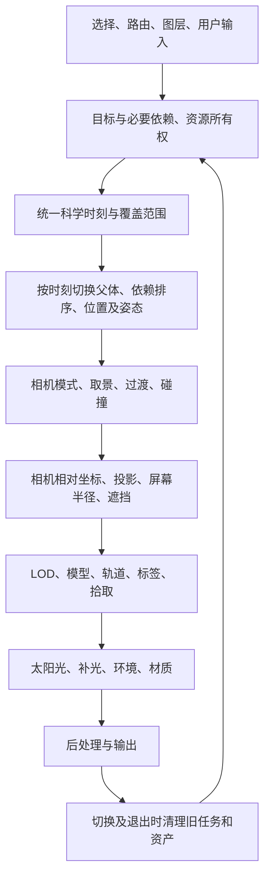

# NASA Eyes源码全局架构分析与能力保持规则

2026-10-31。架构依据仍为《太空之眼平台架构书》，本文件负责解释源码机制、现有对应实现、依赖及回归要求，不另立架构。应用基线为738a9c539，核心0.0.44、SDK0.0.35、网页0.0.52。

本轮只整理分析和执行规则，不替换现有渲染器，不重写已完成能力，不修改太阳默认效果。

## 结论

学习NASA Eyes的重点是协同顺序：同一科学时刻先确定父子关系、位置和姿态，相机据这些状态构图，再由同一相机计算显示比例、可见性、标签与拾取，最后完成材质、后处理及资源清理。相机、标签、轨道、光照不能各自维护互相矛盾的目标、时间或坐标。

太空之眼继续采用TS数据插件→受控SDK→Rust/Bevy WASM，Next负责宿主界面。NASA的Controller、Component、Manager机制转译为我们的数据责任、状态契约和Bevy系统顺序；不照搬Three.js引擎，不引入第二套场景和相机。Nyx、STK仍在后续服务器路径。

## 证据范围与可重复性

E1：用户本地`C:/Users/stone/Documents/solarsystem/eyes/src`，参考仓库HEAD为4a8a83be2ff8298d7fe26fc5c9bbfe47f2fee7db。该HEAD用于定位工作树来源，不等同于确认工作树所有文件与提交完全一致。每个实际文件的SHA256另见证据清单。

共索引1130个文件：engine233、vendor633、ui119、styles85、i18n27、data10、app8、runtime5、models4、dyn3、framework2、main.js1。全文件路径、长度、行数、内容哈希和引擎相对导入检查见[evidence/source-inventory.json](evidence/nasa-global-architecture-2026-10-31/source-inventory.json)。引擎相对导入未发现缺文件。

“索引全部文件”不等于“每行算法均已证明正确”。主要运行链已阅读相关实现；清单中`chain-reviewed`表示本轮检查过关键方法，`indexed-not-line-by-line`表示尚未逐行验收。第三方vendor、UI文案、故事脚本和未识别恢复模块不冒充已完成语义审查。恢复文件含重名类和数字后缀，必须沿实际导入与public-api追踪，不能按文件名直接合并。

E2：太空之眼当前源码及上一版实际GPU证据[evidence/nasa-framing-hover-0.0.52](evidence/nasa-framing-hover-0.0.52/README.md)。上一版CI41177796388已通过。本轮重新执行的完整检查另存证据目录；静态分析不新增GPU效果通过声明。

E3：用户指定[太阳系参考站](https://solar-system-atlas.pages.dev/solar/)，公开脚本`/solar/assets/solar.js`已读取，SHA256为83ff217738979b60fd8e79f455260c4e8952abc7fa05d25f548f06b24c6dd8c0，2336541字节。[静态定位清单](evidence/nasa-global-architecture-2026-10-31/atlas-source-index.json)记录函数、行号及字符偏移。完整第三方脚本只保存在忽略缓存，不纳入项目MIT源码。

参考站浏览器读取超时，因此本轮对它的算法结论来自公开代码；尚未完成实际画面、交互和帧时验收，不根据静态代码宣称其视觉或性能已经实测。

复核方式：按清单路径在本地源码中查看下表方法，例如`Get-FileHash -Algorithm SHA256 -LiteralPath 'C:/Users/stone/Documents/solarsystem/eyes/src/engine/core/Engine.js'`对照该文件清单。参考站可用`Invoke-WebRequest`重新获取已登记的脚本URL后比对哈希，线上版本可能变化，不沿用旧偏移强行套新版本。

## NASA整体运行链

这张图描述依赖关系，不要求每帧阻塞等待网络。科学状态发布与资源就绪分开，旧画面在有效范围内保留，关键依赖优先；无关对象加载不得阻塞科学时间。

## 模块映射与当前差距

下表NASA路径相对E1的`engine/`，太空之眼路径相对项目根。文件存在不代表行为完全对齐。

| 环节 | NASA证据和方法 | 我们的责任与现状 | 后续必须保持的关系 |
|---|---|---|---|
| 主循环 | `core/Engine.js:_loop`区分真实帧差与仿真时间，先场景、后视口与视觉、再渲染 | `clock.rs`、`runtime.rs`、`renderer.rs`和宿主更新链；已有高倍率跨段回归 | 相机惯性用真实时间，轨道/姿态用科学时间；网络不进入同步渲染等待 |
| 状态依赖 | `core/Scene.js:__update`先保存旧状态、切父体与覆盖，再`DependencyGraph.update` | `platform/solar-system.ts`父体/控制器求值，SDK发布；核心不另算星历 | 同一时刻先父体后子体，方向依赖和关节依赖不能遗漏；保留循环检测和缺失诊断 |
| 选择与路由 | `SelectionManager-562.js`独立选择，标签可抑制重复拾取，导航保留时间 | `scene-link.ts`、宿主选择与`picking.rs` | hover、selected、focus、follow分别表达；悬停不得移动相机或改时间 |
| 相机 | `CameraManager.js`创建一次相机；`Cameras.js`投影拟合；`CameraScripts.js`模式取景 | `camera_intent.rs`、`camera_framing.rs`、`camera_motion.rs`、`camera_collision.rs`，已接入拟合与系统距离 | 模式切换只替换策略；保留最终相机碰撞、FOV及原点一致；Follow不能套Nearby位移 |
| 缩放与惯性 | `controllers/ZoomController.js`乘法平滑作用于离地高度并限制范围 | 现有运动积分与输入门控有回归；后台失焦清理会丢弃排队缩放已记录 | 单独区分宿主意图与原生鼠标残余；不得为后台验证绕过碰撞或改变正常拖动规则 |
| 大尺度坐标 | `Entity-62.js:__updateCameraVariables`、`CameraComponent.js`、`ThreeJsHelper`相机相对显示 | f64科学状态→减局部原点→显示比例→f32 | 主星、卫星、轨道、灯方向与拾取使用同一轴向和比例；不能按视觉需要改真实半径 |
| 可见性 | `VisibleInterval.js`区分像素/归一半径/深度；实体遮挡与覆盖决定显示 | `label_visibility.rs`、`screen_layout.rs`、`renderer.rs`已有像素滞回及固定锚点 | 标签、标记、拾取跟随对象可见性；不要只用“是否选中”或距离常数各算一套 |
| 标签 | `LabelManager-563.js`类别权重、`LabelQuadtree`及中心保留区 | 已取消多槽位搬移，使用固定锚点优先级碰撞隐藏 | 不恢复标签挤位跳动；若补中心保留区，需同时验收中心目标、密集卫星与点击 |
| 轨道 | `OrbitLineComponent.js`由当前状态推导瞬时轨道、按角度展开，`LineMesh`管理宽度 | `orbit_lines.rs`解析椭圆360段，科学输入与显示预算分开 | 保留闭合、父体原点和当前端点；不能用直线连接缺失段或用艺术样条伪造轨道 |
| 人造卫星拖尾 | `TrailComponent.js`、`TrailShader`、`TrailManager.js`按时间/参考体渐隐并处理hover | 过去有效轨迹、断点、渐隐及悬停峰值线宽已接入；逐顶点宽度收尖未完成 | 完整自然轨道与过去拖尾保持分类；移植线网格时同时保持渐隐、深度和CPU预算 |
| 模型与姿态 | `ModelComponent`、`AlignController`、`ModelAnimateController`按科学时刻求姿态/关节/clip | `model_joints.rs`、`joint_render.rs`及TS姿态来源；已匹配代表模型关节 | clip与单轴对日关节分别验证；无clip的模型不伪称骨骼动画已播放；姿态缺失可追溯 |
| 资源 | `ResourceManager.acquire/release`共享Promise、引用计数；已完成资源零引用延迟15秒回收 | TS请求/取消/缓存、核心asset ownership已有基础；需要统一观测所有队列 | 不直接照搬15秒；建立预算内保留和退出清空策略，迟到请求不得复活旧场景 |
| 纹理LOD | `TextureLOD`新资源成功前保留旧uniform；`SpheroidLOD`、WMTS分层 | `face_texture.rs`、外置资源及七级银河LOD | 成功后交接，失败保留可用层；不将纹理/星表/数值表塞回WASM |
| 光照 | `LightSourceComponent`注册光源，`MaterialUtils`排除实体自身光源；CameraManager管理辅助光 | 唯一太阳DirectionalLight+独立PointLight补光；WebGL上限1已修复 | 太阳外观自发光与照亮行星的灯分开；修日冕不得改变行星日夜面或让太阳受照 |
| 星环与环境 | `RingsComponent`分别采样上下表面，处理主星/环遮影；`DynamicEnvironmentMapComponent` | 双面环shader、银河IBL已有；不等于全部环影/动态环境已对齐 | 上下表面、光源方向、轴向、深度和遮挡共同测试；背景不能当近距离受照球体 |
| 后处理 | `CameraComponent`持有Render→Outline→Bloom，后两者初始关闭 | Bevy HDR、KhronosPbrNeutral、受限Bloom已存在 | 全局曝光不能当太阳局部强度；后处理变化同时检查星空、行星、环和金属模型 |
| 生命周期 | 组件load/unload、场景移除及资源释放分别拥有责任 | session归属、generation/revision及退出释放已有回归 | 原子确定新目标及所有者，清理旧引用；“隐藏”与“释放”不混为一谈 |
| 故事/比较/其他工具 | 恢复目录含Story、Comparison、距离/视线、WMTS等 | 尚非全部实现或验收 | 按第一版大纲逐项确认，不能为了“源码全覆盖”提前把全部功能塞进核心 |

## 我们的组织方式

保持现有边界，只在当前代码承载不清时逐步抽出责任；不另建平行框架。

1. **TS数据层**拥有目录、父子关系、DYN求值、姿态来源、资源描述、任务请求及取消；维护关键依赖闭包和有界缓存。
2. **核心状态层**拥有SDK权限、对象身份、统一时间、科学状态、选择和相机意图、资源归属及版本；不接收插件任意Bevy操作。
3. **显示准备层**由核心现有相机/坐标/可见性模块产生同一帧可复用的观察结果：最终相机、原点、比例、屏幕半径、遮挡、焦点及层开关。优先复用现有状态；若需要新SDK批量协议，必须另做具体设计。
4. **显示执行层**分别处理实体材质、轨迹、标签、拾取、星空与太阳特效，但消费同一观察结果。`renderer.rs`当前3097行，后续按这几项逐步抽离，先保持行为等价，不能一次重写。
5. **宿主界面**负责操作和展示状态，不重做一套相机、计时器或对象可见性；spacelibre品牌保持。

### 每次改动必须写清的12条约束

- 唯一科学时刻、时间尺度和播放状态；视觉动画另有显式暂停/速度含义。
- 父体按时刻变化；位置、速度、姿态及轨迹原点在同一时刻对应。
- 真实半径、模型取景范围、轨道半径、屏幕标记尺寸分别命名。
- 最终相机统一决定显示坐标、投影、深度、LOD、拾取与补光位置。
- hover只改变自身显示状态，不改变选择/聚焦/时间。
- 可见性共同驱动形体、标记、标签和交互；透明或失效对象不能留下点击区。
- 自然轨道和人造卫星过去拖尾保持各自时间语义、断点及预算。
- 太阳自发光、行星受光、环境反射、日冕、Bloom和眩光分别控制。
- 资源外置、按需获取；未就绪时保留有效层，取消请求必须检查迟到结果。
- 对象/材质/纹理/请求/监听有所有者；退出时可验证释放。
- 每帧CPU/GPU成本有上限；相机靠近不等于无限增加采样或画满屏透明层。
- 每个旧能力在变更影响表中写“保持/扩展/明确替代”；不得悄悄删除、关掉来让新效果通过。

## 用户提供参考站的太阳方法

E3能证明的内容如下；它是另一个太阳视觉参考，NASA仍是整体交互基线。

| 层 | 公开代码中的方法 | 太空之眼采用方向 |
|---|---|---|
| 表面 | 自定义shader、程序细节与太阳贴图混合；有普通与H-alpha资源 | 保留已批准的程序表面和橙红配色，不把参考站贴图直接替换进来；保留一个太阳对象和一致外观状态 |
| 色球/内层 | 不同球壳、独立时间与强度，薄层半径约1.015倍 | 薄层和表面分别调参，但共享原点、半径、时间和同一颜色配置 |
| 日珥 | 多根立体曲线管束、鞘层，沿弧线细丝动态变化，局部活动拱廊按近景显现 | 保留现有文献约束细丝、立体深度、前后遮挡；视觉细节不能替代文献参数或MHD求解 |
| 日冕 | 视线经过三维密度场，近景18步积分；密度随半径衰减，内外冕分开，平滑收边 | 在现有WGSL中评估同类低步数体积积分和LOD；不是再贴一个发光平面，也不同时运行重复体积层 |
| 屏幕细节 | 太阳屏幕半径约7→26px渐增日珥/内层，8→65px增加表面细节；近景拱廊另有更高阈值 | 用最终相机的真实投影半径和滞回调度，阈值需在本平台测量，不直接把像素数当通用常数 |
| Bloom | 真实比例视图构造strength0.3、radius0.62、threshold1.04的通道，使用半分辨率 | Bevy与Three色调映射和单位不同，不照抄数值；比较亮部能量及黑场，保留现有全局色彩管理 |
| 镜头眩光 | 独立屏幕光晕、条纹和ghost，不属于太阳实际半径 | 可做受控低成本屏幕效果，受太阳视线和遮挡控制；不能压白整幅星空或穿透行星 |
| 爆发粒子 | 专门空间天气层开启时才运行，不在主视图无条件喷射 | 继续遵守用户“靠近才触发”和GPU硬上限，太阳风不当普通火焰漫射 |

参考站有图谱视图与真实比例视图，不能把两种视图各自的太阳/相机创建路径移植成我们两套太阳。当前结论是借鉴分层、投影LOD、低步数积分和曝光控制的组合；尚未证明单个公式就能复现其最终画面。

### 当前太阳能力如何保留

`solar_surface.rs`管理程序表面；`stellar_render.rs`管理日珥/体积层和近远景滞回；`stellar_tuning.rs`维护受控参数，外置`solar-surface.wgsl`、`stellar.wgsl`、`prominence.wgsl`负责显示；`renderer.rs`管理HDR/Bloom及真实太阳灯。这些保留，先统一输入和职责。

当前体积shader已有4—24步硬限制，近景创建/远景回收、前后深度和暂停参数已有实现。需要验证的是它们的**组合**：投影细节是否连续、总透明覆盖面积、跨层亮度是否守住黑场、太阳表面是否始终只有一份有效输出。不能通过关掉表面、日珥或自然光来换取新日冕看起来正确。

用户此前确认的橙红视觉目标保留；不同观测波段必须作为显式模式提出，不能随距离或选择自动跳成不同配色。“日珥、日冕、太阳风”分别建模；E3是视觉近似，不代表得到核聚变、完整辐射转移或MHD算法。

## 全局推进顺序与不可跳过的验收

| 顺序 | 本批产物 | 同时回归的旧能力 |
|---|---|---|
| 1 观察状态与输入一致性 | 梳理最终相机、FOV、原点、像素半径和输入所有权，先解决后台/宿主意图丢失的独立问题 | 拖动/滚轮/按钮/键盘/触摸、失焦后恢复、碰撞、Nearby/System/Follow、宽屏竖屏 |
| 2 可见性与交互协同 | 形体/标签/拾取/hover共享状态；在现有实现中抽出明确边界 | 密集地球卫星标签不跳；离屏/遮挡消失；月球与木卫二悬停、环孔不误选 |
| 3 太阳分层外观 | 一个太阳对象、统一配色和投影LOD，先比较同视角输出，再调整日冕/日珥/Bloom | 初始化→选择→逼近→拉远外观连续；暂停、导入导出、GPU预算、日夜面与银河黑场 |
| 4 轨迹线网格补齐 | 在保留解析轨道及科学预算的前提下补可变线宽和抗锯齿 | 月球闭合圆滑、人造卫星过去拖尾、缺口断线、hover恢复、480倍跨段 |
| 5 资源/模型与全目录扩展 | 测量切换等待和内存后逐任务补齐；按科学时刻播放声明的clip和关节 | ISS10关节、NOAA对日、Juno模型、任务阶段父体切换、取消快速切换、退出重入 |
| 6 第一版集中验收 | 按《第一版规划与验收》逐项登记成对证据与未完成项 | 全流程而非孤立截图，不能将基础测试通过等同全部NASA对齐 |

每一批先列影响模块、依赖、旧功能保持方式与失败恢复，再改实现。结构抽离与效果变化分开提交，变更后重新运行适用全检，接入渲染器的行为变化必须实际GPU验证；patch版本、CHANGELOG、提交推送及gh跟踪沿用现有规则。

## 代表场景固定回归表

| 场景 | 最低检查内容 |
|---|---|
| 启动太阳系→太阳→拉远 | Sun居中、一份表面、配色连续、近景细节渐进、远景不运行重体积效果 |
| 地球→月球→系统→总览 | 主星/卫星真实比例，月球围绕地球，闭合轨道、hover、时间保留 |
| 木星System | 四颗主要木卫构图、标签碰撞/遮挡、单对象轨道高亮 |
| 土星近景及系统 | 星环正反、主星/环遮挡、环孔拾取、近景轨道渐隐、拉远恢复 |
| ISS原始链接480倍 | 时间跨真实覆盖、宿主地球球形和深度、拖尾与10关节、非关键对象失败不暂停 |
| MRO与Chandra | 宿主关系、Nearby/Follow、不同FOV、自然/补光、模型与父体裁剪 |
| 银河七级LOD | 与星表共用视场与科学视差、深黑、缓存预算、资源不进WASM |
| 快速A→B→C、退出重入 | 迟到结果不复活A/B，订阅与GPU资源清理，最终只响应C |

每条登记相同对象/时刻/FOV/模式/光照、预期和实际、截图/录像或数值证据。NASA对照、参考站观感、本平台结果三者分别记录，不能互相冒充。
